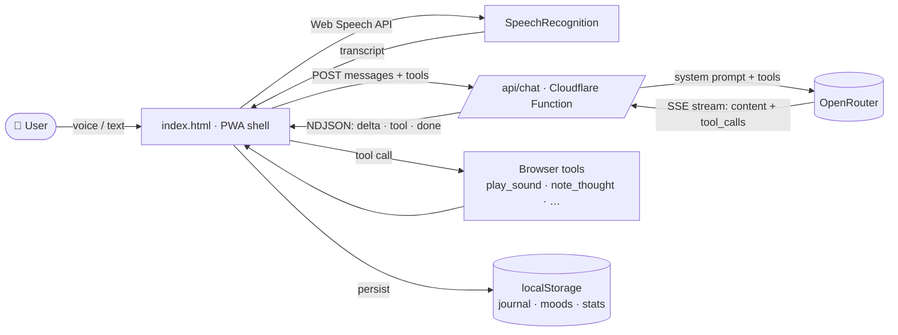
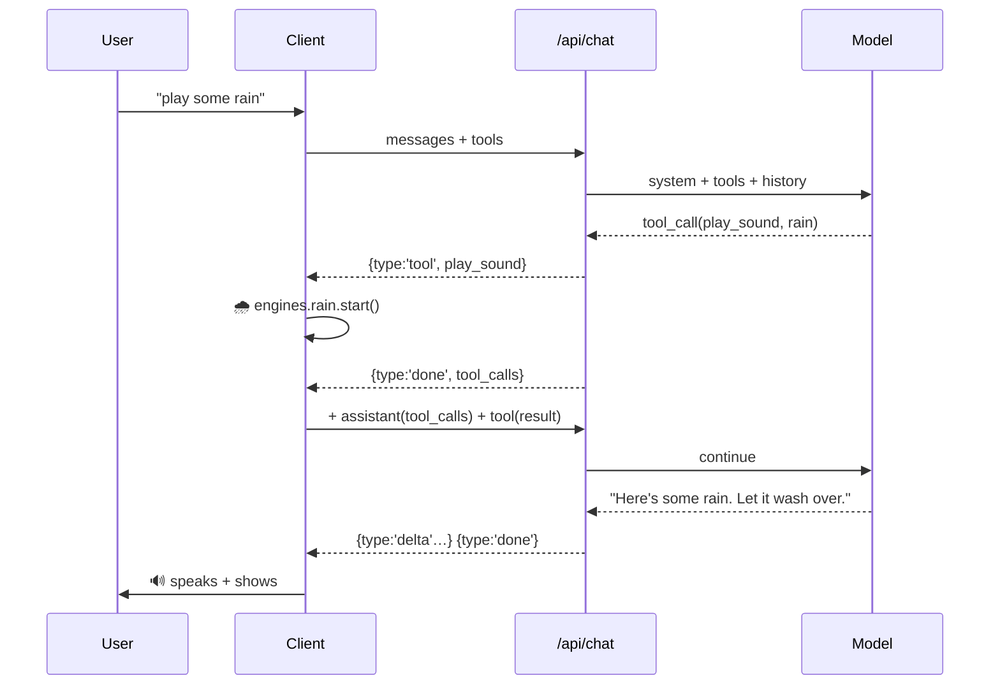

<div align="center">


# Calmora

### A voice-first wellbeing companion that *listens, comforts, remembers — and acts.*

A private, installable, voice-driven mental-wellness app. Talk to a glowing orb (or type), get grounded therapeutic conversation, play live-synthesised soundscapes, breathe, journal, and drift into sleep — all in one fast, single-file web app with **zero build step**.

[](#)
[](#)
[](#)
[](#)
[](#)
[](#license)

</div>

---

> ⚠️ **Important:** Calmora is a wellbeing **companion**, not a medical device, therapist, or crisis service. It does not diagnose, treat, or replace professional care. If you are in danger, contact your local emergency services immediately. See [Safety](#-safety) and the [Disclaimer](#-disclaimer).

---

## 📓 Project logbook

A completed **AI Project Logbook** for Calmora (following the IBM EdTech Youth
Challenge template) lives in [`logbook/`](logbook/README.md): an editable
[Word document](CALMORA-AI-Project-Logbook.docx), a
[submission-ready PDF](CALMORA-AI-Project-Logbook.pdf), and the
[Markdown source](logbook/CALMORA-AI-Project-Logbook.md). Team names, school
details, interview notes and test numbers are highlighted in yellow — fill those
in before submitting. Run `python3 logbook/build.py` after editing the source.

---

## ✨ Why Calmora

Most "AI wellness" apps are thin chat wrappers. Calmora is a **complete, calm, tactile environment** built around four ideas:

1. **Voice you can feel** — a living orb that glows **blue** while listening, **yellow** while thinking, **orange** while speaking.
2. **It actually does things** — a true voice *agent* with tools: it can play a soundscape, save your thought to the journal, start a breathing exercise, or tuck you into sleep mode — then narrate what it did.
3. **Genuinely private** — your journal, mood, and conversation stay in your browser. Nothing about you is stored on a server.
4. **Works like a real app** — installable PWA, offline-capable, no app store.

---

## 🧭 Table of contents

- [Highlights](#-highlights)
- [Launch film](#-launch-film)
- [The orb](#-the-orb)
- [Features](#-features)
- [Quick start](#-quick-start-60-seconds)
- [Architecture](#-architecture)
- [Project structure](#-project-structure)
- [Deployment (Cloudflare Pages)](#-deployment-cloudflare-pages)
- [Configuration](#-configuration)
- [How the voice pipeline works](#-how-the-voice-pipeline-works)
- [How the AI agent & tools work](#-how-the-ai-agent--tools-work)
- [Soundscapes & the Frequency Lab](#-soundscapes--the-frequency-lab)
- [Privacy & data](#-privacy--data)
- [Safety](#-safety)
- [Customization](#-customization)
- [Browser support](#-browser-support)
- [Troubleshooting / FAQ](#-troubleshooting--faq)
- [Roadmap](#-roadmap)
- [Disclaimer](#-disclaimer)
- [License](#license)
- [Acknowledgements](#-acknowledgements)

---

## 🌟 Highlights

| | |
|---|---|
| 🎙️ **Voice-first** | Tap to talk, watch your words fill the prompt bar, auto-send 2s after you stop. Hands-free auto-continue keeps the conversation flowing. |
| 🔵🟡🟠 **Living orb** | Real audio-reactive orb with colour states for idle / listening / thinking / speaking. |
| 💬 **Beautiful chat UI** | Toggle between the orb view and a full streaming chat (bubbles, avatars, typing indicator, caret, stop button). |
| 🧠 **Therapeutic AI** | A compact system prompt that listens, validates, *then actually helps* — CBT reframes, behavioural activation, grounding, psychoeducation. |
| 🛠️ **Tool-using agent** | Plays sounds, journals thoughts, launches exercises — a real agentic loop, not just chat. |
| 🌧️ **Live audio engine** | Rain, ocean, forest, brown noise, fireplace, night, cave — all synthesised in-browser with the Web Audio API. No audio files. |
| 🧘 **Evidence-based tools** | 6 breathing patterns, 5-4-3-2-1 grounding, PMR, ACT values clarification, journaling, mood insights. |
| 📴 **Offline PWA** | Installable, runs offline (the shell + every wellness tool work without a connection). |
| 🔒 **Local-first** | Journal, moods, stats, and history never leave your device. |
| 🚀 **One file, no build** | The whole app is a single `index.html`. Deploy anywhere. |

---

## 🎬 Launch film

A 30-second motion-graphics launch film lives in [`video/`](video/) — no build step, no external assets, in keeping with the project:

- **[`video/calmora-launch.html`](video/calmora-launch.html)** — the film. 1920×1080 at 120 BPM, all visuals drawn in Canvas 2D, score synthesised live with Web Audio, four voiceover clips, chapter scrubbing, PNG frame export and WebM recording. Serve the repo and open `/video/calmora-launch.html` (voiceover needs `http`, not `file://`).
- **[`video/PRODUCTION_BLUEPRINT.md`](video/PRODUCTION_BLUEPRINT.md)** — the full scene-by-scene prompt blueprint: brand profile and magic moment, VO script with timecodes, camera / lighting / audio cues, AI asset prompts, beat map and compliance notes.
- **[`video/storyboard.png`](video/storyboard.png)** — 12 captioned key frames pulled directly from the master.

---

## 🔵 The orb

The orb is the emotional centre of the app. Its colour tells you what Calmora is doing:

| State | Colour | Meaning |
|---|---|---|
| **Idle** | 🔵 Blue | Calm and ready — tap to talk |
| **Listening** | 🩵 Bright blue | Hearing you (pulsing with your voice) |
| **Thinking** | 🟡 Bright yellow | Sitting with what you said |
| **Speaking** | 🟠 Orange | Calmora is replying |

It floats, orbits particles, ripples while listening, and gently breathes — designed to be soothing to look at, never frantic.

---

## 📦 Features

<details>
<summary><strong>🗣️ Conversation</strong></summary>

- **Voice or text** — switch freely; both end up in the same thread.
- **Live transcription** in the prompt bar, **2-second auto-send** after you stop talking.
- **Streaming replies** (SSE/NDJSON) token-by-token, with a typing indicator and a stop button.
- **Auto-continue** — the mic reopens after Calmora finishes, for hands-free back-and-forth.
- **Reasoning never leaks** — chain-of-thought is filtered on the server *and* client.
- **Text-to-speech** with selectable browser voice and pace.
- **Transcript** panel with export.

</details>

<details>
<summary><strong>🛠️ Voice Agent (tools)</strong></summary>

Calmora can act, not just talk:

- 🌧️ `play_sound` — rain / ocean / forest / brown / fire / night / cave
- 🔇 `stop_sounds` — quiet everything
- 📝 `note_thought` — save something you said to the **journal** (with optional mood)
- 🌬️ `start_breathing` — launch a guided breathing exercise
- 🌿 `start_grounding` — open 5-4-3-2-1 grounding
- 🌙 `sleep_mode` — start sleep mode with a fading soundscape

Try: *"play some rain for me"*, *"remember that I'm proud of how I handled today"*, *"help me breathe"*.

</details>

<details>
<summary><strong>🧘 Calm toolkit</strong></summary>

- **Calm me now** — a 90-second guided reset (breath → body → present moment).
- **Guided breathing** — Coherent 5.5, Box 4-4-4-4, Physiological sigh, 4-7-8, Tactical, Long exhale.
- **5-4-3-2-1 grounding** — a slow walk through your senses.
- **Progressive muscle relaxation** — tense & release, head to toe.
- **Values clarification** — an ACT-based reflection that can save to your journal.
- **Journal** — prompts, moods, search, export.
- **Mood check-ins + insights** — a gentle 14-point mood curve and "gentle numbers" (no streaks-shaming).

</details>

<details>
<summary><strong>🌧️ Soundscapes & Frequency Lab</strong></summary>

- 7 fully-synthesised soundscapes you can layer freely, each with volume + depth.
- **Frequency Lab**: binaural beats (delta/theta/alpha/SMR, Schumann) and Solfeggio tones (174–963 Hz), with adjustable carrier.
- **Sleep mode** — pick a sound, set a timer, drift off as it fades.

</details>

<details>
<summary><strong>📱 PWA & privacy</strong></summary>

- Installable, standalone, offline-capable service worker.
- Everything personal (journal, moods, stats, history, settings) lives in `localStorage` — on your device only.
- Export or erase all your data at any time.

</details>

---

## ⚡ Quick start (60 seconds)

No dependencies. No build. Pick one:

```bash
# Option A — any static server
npx serve .            # or: python3 -m http.server 8000

# Option B — just open it
open index.html        # (voice/AI need https or localhost; see Browser support)
```

Then visit the URL. For **real voice + AI**, open it over **https** or **localhost** (browsers block the microphone otherwise).

> 💡 Without a backend you'll get the **offline companion** (pattern-matched empathetic replies) and all wellness tools. For real streaming AI + tools, [deploy the `/api/chat` function](#-deployment-cloudflare-pages).

---

## 🏗️ Architecture



**Two tiers, cleanly separated:**

- **`index.html`** — the entire client: UI, orb, Web Audio engine, wellness tools, agent loop, PWA. Talks to the server over a tiny NDJSON streaming protocol.
- **`chat.js`** — a Cloudflare Pages Function (`/api/chat`) that owns the **system prompt**, the **key**, **rate limiting**, and **tool definitions**, then streams OpenRouter back to the client. The client *never* sees your server key.

---

## 📁 Project structure

```
.
├── index.html            # the whole app (UI + logic + styles) — single file
├── chat.js               # Cloudflare Pages Function  →  /api/chat  (AI + tools + limits)
├── sw.js                 # service worker (offline PWA shell)
├── manifest.webmanifest  # PWA manifest
├── icon.svg              # app icon (maskable)
├── README.md             # you are here
├── CALMORA-AI-Project-Logbook.docx   # completed AI Project Logbook (editable)
├── CALMORA-AI-Project-Logbook.pdf    # completed AI Project Logbook (to submit)
└── logbook/
    ├── CALMORA-AI-Project-Logbook.md # logbook source of truth
    ├── build.py                      # regenerates .docx + .pdf from the .md
    └── README.md                     # how to edit and submit the logbook
```

**Deploy layout (Cloudflare Pages):**

```
/                         # static root
├── index.html
├── sw.js
├── manifest.webmanifest
├── icon.svg
└── functions/
    └── api/
        ├── chat.js       # → handles POST /api/chat
```

---

## 🚀 Deployment (Cloudflare Pages)

Calmora is built for **Cloudflare Pages** (free tier is plenty).

1. **Push this repo** to GitHub/GitLab.
2. In the Cloudflare dashboard → **Pages → Create project → Connect to Git**.
3. Build settings:
   - **Framework preset:** *None*
   - **Build command:** *(leave empty)*
   - **Output directory:** `/` (root)
4. **Deploy.** (Functions are detected automatically from `functions/api/`.)
5. **Set environment variables** (Pages → Settings → Environment variables) *after* the first deploy:

   | Variable | Required | Default | Purpose |
   |---|---|---|---|
   | `OPENROUTER_API_KEY` | ✅ (or BYOK) | — | Server-side fallback AI key (users can also bring their own). |
   | `OPENROUTER_MODEL` | optional | `openrouter/free` | Default model id. |
   | `ALLOWED_ORIGIN` | optional | `*` | CORS allow-list for `/api/chat`. |
   | `MAX_CONCURRENCY_SERVER` | optional | `2` | Concurrent slots for server-key users (per isolate). |
   | `MAX_CONCURRENCY_BYOK` | optional | `8` | Concurrent slots for bring-your-own-key users. |
   | `APP_URL` | optional | `https://calmora.pages.dev` | Sent as OpenRouter `HTTP-Referer`. |

6. Done. Open your `*.pages.dev` URL, allow the microphone, install it from the browser menu.

> **Rate limiting** is concurrency-only (in-memory, per isolate): a slot frees the instant a stream ends — no time windows, no token buckets, no databases required.

---

## ⚙️ Configuration

Most settings live in the in-app **Settings** panel (top-right gear) and persist locally:

| Setting | What it controls |
|---|---|
| **OpenRouter API key** | Optional BYOK — uses *your* quota; otherwise the server key is used. Stored only on-device. |
| **API endpoint** | Defaults to your `/api/chat`. Point anywhere OpenAI-compatible. |
| **Model** | Any OpenRouter model id (e.g. `openrouter/free`). |
| **Auto-continue listening** | Reopen the mic after each reply. |
| **Speak replies / Voice / Pace** | Text-to-speech controls. |
| **Large captions / Reduce motion** | Accessibility. |
| **Emergency & trusted person** | Shown on the safety card. |

> 🧰 **Tools need a function-calling-capable model.** `openrouter/free` sometimes routes to models without tool support (chat still works; tools just won't fire). For reliable tools, pick a known tool-capable model (e.g. a GPT / Claude / Llama-Instruct id).

---

## 🎙️ How the voice pipeline works

Calmora's voice is hardened against the classic `webkitSpeechRecognition` traps (random stops, restart loops, silent failures):

```
tap mic ──► SpeechRecognition (continuous=false, interimResults=true)
            │
            ├─ onresult ─► transcript fills the PROMPT BAR live
            │              └─ 2 s of silence ─► auto-send
            ├─ onspeechend ─► stop (one utterance, no infinite loop)
            ├─ onerror    ─► surfaced as a friendly toast (never silent)
            └─ onend      ─► commit whatever was heard
                              └─► userTurn() ─► AI ─► TTS ─► auto-continue
```

Key reliability choices:

- **`continuous=false` + `onspeechend`** — capture one utterance, then stop. No more "won't stop listening" loops.
- **No competing `getUserMedia`** — a second mic stream starves recognition, so the orb pulses synthetically while listening.
- **Hard 14s cap + double-commit guard** — it always stops, even if events misbehave.
- **Transcript in the prompt bar** — you see exactly what will be sent, and it sends 2 s after you stop.

> Requires a Chromium browser (Chrome / Edge / Brave / Arc). Firefox lacks the Web Speech API — there you can still type.

---

## 🤖 How the AI agent & tools work

Calmora isn't a single prompt → single reply. It runs a **multi-round agent loop**:

1. Your message + the conversation go to `/api/chat`, which attaches the **system prompt** and **tool schemas**.
2. The model streams a reply **and/or tool calls**. The server emits NDJSON events: `delta` (text), `tool` (a completed call), `done(finish_reason)`.
3. **Tool calls execute instantly in the browser** — the rain starts playing, the note saves, the exercise opens.
4. If the model acted without speaking, the client feeds the **tool results back** and asks for one short spoken sentence (capped at 3 rounds).
5. The reply streams into the chat, is spoken aloud, and the mic reopens.



The system prompt instructs the model to **act, then narrate** — never call a tool in silence.

---

## 🌧️ Soundscapes & the Frequency Lab

Every sound is **synthesised live** with the Web Audio API — no audio files, no downloads, no loops to license.

- **Soundscapes:** filtered noise + procedural events (raindrops, bird chirps, fire crackles, ocean LFOs, cave drips with convolution reverb). Layer as many as you like.
- **Frequency Lab:**
  - **Binaural beats** — true stereo (carrier left, carrier+beat right) for delta/theta/alpha/SMR + Schumann 7.83 Hz. *Headphones recommended.*
  - **Solfeggio tones** — pure 174–963 Hz drones with gentle amplitude modulation.

---

## 🔒 Privacy & data

- **Local-first.** Your journal, moods, stats, conversation history, and settings are stored in `localStorage` on your device. They are **never** sent anywhere except the conversation turns that go to the AI.
- **The AI only sees message text.** It does not receive your journal, moods, or stats (a light, anonymised mood average is optionally included for tone).
- **Keys:** your BYOK key (if you enter one) stays in your browser and is sent only to your own `/api/chat`. The server key never reaches the client.
- **You own your data:** export everything (or the journal/transcript alone) and erase all data instantly from the **You** panel.

---

## 🛟 Safety

- **Crisis detection** scans every message for self-harm / suicide language. If triggered, Calmora:
  - responds with calm, steady care,
  - shows a **safety card** with your configured emergency number, trusted person, and international helplines (findahelpline.com, Crisis Text Line),
  - never discusses methods or means.
- Configure your **local emergency number** and a **trusted person** in Settings so the card is one tap away.
- **Calmora is not a crisis service.** If you are in immediate danger, contact local emergency services now.

---

## 🎨 Customization

<details>
<summary><strong>Recolour the orb</strong></summary>

In `index.html`, the state colours are CSS variables — change four lines:

```css
body.state-idle{      --tint:#3b82f6; --orb-glow:rgba(59,130,246,.4);  …}   /* blue   */
body.state-listening{ --tint:#38bdf8; --orb-glow:rgba(56,189,248,.62); …}   /* cyan   */
body.state-thinking{  --tint:#facc15; --orb-glow:rgba(250,204,21,.52); …}   /* yellow */
body.state-speaking{  --tint:#fb923c; --orb-glow:rgba(251,146,60,.55); …}   /* orange */
```

</details>

<details>
<summary><strong>Add or change agent tools</strong></summary>

1. Add a tool schema to the `TOOLS` array in **`chat.js`**.
2. Add a matching branch to `executeTool()` in **`index.html`** (this is where the browser *does* the thing and returns a result string).
3. That's it — the model discovers the tool from the schema automatically.

</details>

<details>
<summary><strong>Tune the personality</strong></summary>

Edit `SYSTEM_PROMPT` in **`chat.js`** (the one that's actually used server-side). Keep it short for speed; the prompt is deliberately compact so responses stay fast and conversational.

</details>

---

## 🌐 Browser support

| Capability | Chrome / Edge / Brave / Arc | Safari | Firefox |
|---|---|---|---|
| App + wellness tools | ✅ | ✅ | ✅ |
| PWA install | ✅ | ✅ (Add to Home Screen) | ⚠️ partial |
| **Voice input** | ✅ | ⚠️ partial | ❌ (no Web Speech API — type instead) |
| Text-to-speech | ✅ | ✅ | ✅ |
| Audio engine | ✅ | ✅ | ✅ |

Voice and AI require a **secure context** (https or localhost) and a granted microphone permission.

---

## ❓ Troubleshooting / FAQ

<details>
<summary><b>The mic doesn't pick up my voice / "Microphone blocked"</b></summary>

Open the site over **https** (or `localhost`) and allow the mic. The in-app sandboxed preview blocks the microphone — test on your real deployed URL. Calmora needs a Chromium browser for voice.

</details>

<details>
<summary><b>It listens but doesn't reply / replies are canned</b></summary>

That's the **offline companion** — meaning `/api/chat` isn't reachable or no key is set. Deploy `chat.js` as `functions/api/chat.js` and set `OPENROUTER_API_KEY` (or enter a BYOK key in Settings).

</details>

<details>
<summary><b>Tools (play sound, save note) don't fire</b></summary>

Your model doesn't support function calling. Switch to a **tool-capable model** in Settings (e.g. a GPT / Claude / Llama-Instruct id on OpenRouter). Plain chat still works regardless.

</details>

<details>
<summary><b>The orb won't stop listening</b></summary>

This was a known `webkitSpeechRecognition` loop, now fixed (`continuous=false` + `onspeechend`). If you still see it, hard-refresh to bust the old service worker.

</details>

<details>
<summary><b>Changes aren't showing</b></summary>

Bump `CACHE` in `sw.js` (e.g. `calmora-v2`) and reload — the service worker caches the shell aggressively for offline use.

</details>

---

## 🗺️ Roadmap

- [ ] In-browser Whisper STT fallback (private, offline) for Firefox/Safari
- [ ] More agent tools (timers, body-scan, gratitude, CBT thought record)
- [ ] Conversation branching & search
- [ ] Multi-language voice (`rec.lang` auto-detect)
- [ ] Optional encrypted cloud sync (end-to-end)
- [ ] Richer chat rendering (gentle markdown for non-voice mode)

Ideas and PRs welcome — see [Contributing](#acknowledgements).

---

## ⚕️ Disclaimer

Calmora is a **wellbeing companion**. It is **not** a medical device, a substitute for professional mental-health care, a therapist, a doctor, or a crisis service. It does not diagnose, treat, cure, or prevent any condition, and it offers no medical or medication advice. If you are struggling or in crisis, please reach out to a qualified professional or your local emergency services. By using Calmora you accept full responsibility for your use of it.

---

## License

Released under the **MIT License**. See [`LICENSE`](LICENSE). Build something kind with it.

<div align="center">

**Be gentle with yourself. You're doing better than you think.** 💙

</div>

---

## 🙏 Acknowledgements

- **[OpenRouter](https://openrouter.ai)** — one API, every model.
- **[Cloudflare Pages](https://pages.cloudflare.com)** — free, fast edge hosting & functions.
- Built on open web standards: **Web Speech API**, **Web Audio API**, **SpeechSynthesis**, **Service Workers**.
- Breathing protocols informed by research on coherent breathing, the physiological sigh (Huberman/Stanford), and 4-7-8 (Weil). Grounding, PMR, and values work draw on DBT, ACT, and classic relaxation traditions.

<sub>If Calmora helps you, consider supporting a mental-health charity in your country.</sub>

## Voice workspace revamp

The workspace now uses a light sage visual system with a desktop navigation rail,
focused voice stage, mood check-in, wellness cards and responsive mobile navigation.
Voice calls expose persistent listening, mute/unmute, an explicit hang-up button,
browser voice identification, live captions, and interruption controls.
“Speaking” is driven by audio playback rather than arriving text tokens. Switching
away from the page or opening a tool cancels active microphone input.

### OpenRouter-only voice calls

**No additional speech API keys or providers are configured.** OpenRouter is the
only keyed AI integration. The browser supplies speech recognition and system
speech synthesis. Start a call once and the microphone stays available across
turns; silence does not hang up. Calmora sends a transcript after a short pause,
streams a concise OpenRouter response into spoken sentences, and returns to
listening automatically. Calls have a live duration, mute/unmute, interrupt and
hang-up controls. The input microphone still supports one-shot dictation.

Recognition stays active during speech playback. A transcript echo filter ignores
words matching the assistant's response; distinct phrases of at least three words
can interrupt playback/generation. The explicit **Let me speak** button is the
reliable fallback for short interruptions or loudspeaker echo. Use headphones for
the best experience. This is best-effort browser barge-in, not full-duplex WebRTC
or an end-to-end audio model. Browser recognition may use a browser-vendor speech
service; it is not guaranteed local/offline. Browser voices and timing vary by OS.

Chrome/Edge over HTTPS are recommended. Microphone permission and speech service
failures end the call with an actionable message. Recognition reconnects after
normal service disconnects. Muting releases the recognizer; hang-up invalidates
late callbacks and cancels speech, generation, timers and microphone resources.
Opening a tool temporarily mutes the call and closing it restores listening.
Backgrounding the app ends the call for privacy. No raw audio is saved by Calmora.

### Development and validation

The app needs no frontend build step. Run `npm install`, `npm test`, and
`npm run dev`. The static preview runs on port 3000 and supports local wellness
tools; `/api/chat` needs Cloudflare Pages (or use a browser OpenRouter key for
direct chat). Tests use simulated recognition and speech; actual microphone,
acoustic echo, provider latency and mobile-browser playback require device QA.

### Production deployment requirements

The visual/interaction revamp is not a claim of enterprise certification. Protect
public paid endpoints with authentication and edge rate-limit rules. Configure a
stable low-latency OpenRouter model rather than relying on a free-model router for
latency-sensitive calls. Complete accessibility and real-device voice QA, provider
privacy/retention review, monitoring, abuse controls and load testing before
enterprise deployment. Browser BYOK storage remains device-local; prefer
server-managed OpenRouter secrets on shared or managed devices.

Design rationale: explicit turn feedback, short spoken replies, interruption and
text alternatives follow the voice interaction principles discussed in
[Voice User Interface Design: A Practical Guide](https://refact.co/insights/digital-product/voice-user-interface-design).

## Nightfall appearance

Calmora now opens in **dark mode by default**, including on devices set to light.
The header and Settings → Appearance offer Dark, Light, and System. The preference
is saved as `calmora:theme`, applied in the document head before stylesheet paint,
and synchronized between the two controls and across tabs. System mode follows
live OS appearance changes; an explicit selection does not. Browser/PWA chrome
uses the resolved theme color, and offline caches include the new stylesheet and
fonts.

The Nightfall design uses green-charcoal surfaces, off-white text, a restrained
sage action color, a pearlescent voice orb, and low-amplitude motion. Listening and
speaking keep text labels as well as animated feedback. Both OS reduced-motion
and the existing in-app Reduce Motion setting disable animation. Fraunces and
Karla are locally hosted under `assets/fonts` with their SIL Open Font licenses;
the interface no longer depends on Google Fonts requests. Latin subsets are
bundled; other scripts use the existing system fallback fonts.

Design references:
- [WCAG 2.2 Contrast (Minimum)](https://www.w3.org/WAI/WCAG22/Understanding/contrast-minimum.html): key text pairs are tested at the normal-text 4.5:1 threshold. This is not a claim of complete WCAG conformance.
- [WCAG Animation from Interactions](https://www.w3.org/WAI/WCAG22/Understanding/animation-from-interactions.html): decorative motion is nonessential and can be disabled.

Validation: `npm test` includes first-paint defaults, stored preferences, selector
synchronization, system appearance changes, and core dark text contrast. Chromium
smoke checks covered 320, 390, 768, 1280, and 1440px widths (no horizontal overflow),
mobile settings, self-hosted font loading, theme persistence, live OS appearance,
reduced motion, and mood persistence. Existing simulated call-flow tests remain
passing. Real-device voice QA remains necessary as documented above.

## Product branding

The user-facing product is **PRIMØSHU by Calmora** (short name: **PRIMØSHU**).
Existing storage keys, repository names, and internal theme APIs remain unchanged
to preserve saved data and compatibility.
